<!--
  DIAVLO FACTORY · github.com/Nikolai-coder

  The blocks between "factory:" markers are written by `python3 -m factory`.
  To change the page, edit factory/registry.json or the text outside the
  markers. How it all works: factory/README.md
-->

<!-- factory:gate -->

<picture>
<source media="(prefers-color-scheme: light)" srcset="assets/rail.day.svg">
<source media="(max-width: 600px)" srcset="assets/gate.night.tall.svg">
</picture>
<picture>
<source media="(prefers-color-scheme: dark)" srcset="assets/rail.night.svg">
<source media="(max-width: 600px)" srcset="assets/gate.day.tall.svg">
</picture>

<!-- /factory:gate -->

<b>DIAVLO builds software, sound and worlds.</b> 
Audio tools that measure instead of guessing, a working method for AI agents, and games and visuals still behind sealed doors.

The Factory is a fiction. Everything it ships is real, and every number on this page is read from the public record.

<!-- factory:lines -->

<a href="https://github.com/Nikolai-coder/diavlo-wav-releases">
<picture>
<source media="(prefers-color-scheme: dark)" srcset="assets/rail.night.svg">
<source media="(max-width: 600px)" srcset="assets/line.diavlo-wav-releases.day.tall.svg">
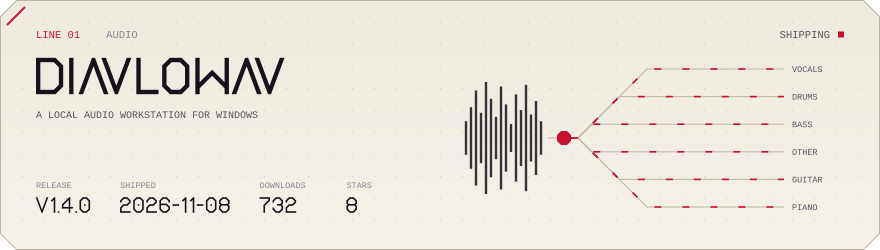
</picture>
<picture>
<source media="(prefers-color-scheme: light)" srcset="assets/rail.day.svg">
<source media="(max-width: 600px)" srcset="assets/line.diavlo-wav-releases.night.tall.svg">
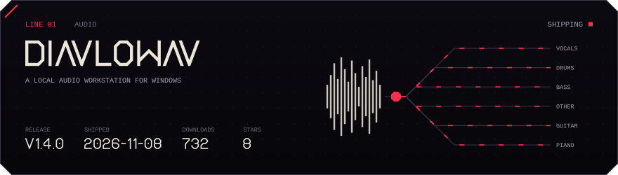
</picture>
</a>

**DIAVLOWAV** · A local audio workstation for Windows: stem separation, mastering, audio-to-MIDI and a model browser that rates every model against your hardware. Processing is local by default, and every figure in the interface is measured, never estimated. Releases are built in CI, checksummed and signed; the app refuses an update whose signature does not match. 
`Rust` `Tauri 2` `React 19` `TypeScript` `FFmpeg` `Demucs` `Basic Pitch` &nbsp;·&nbsp; [Repository](https://github.com/Nikolai-coder/diavlo-wav-releases) · [Latest release](https://github.com/Nikolai-coder/diavlo-wav-releases/releases/latest) · [26-second film](https://github.com/Nikolai-coder/diavlo-wav-releases/blob/main/media/diavlowav-hero.mp4)

<a href="https://github.com/Nikolai-coder/diavlo-mind">
<picture>
<source media="(prefers-color-scheme: dark)" srcset="assets/rail.night.svg">
<source media="(max-width: 600px)" srcset="assets/line.diavlo-mind.day.tall.svg">
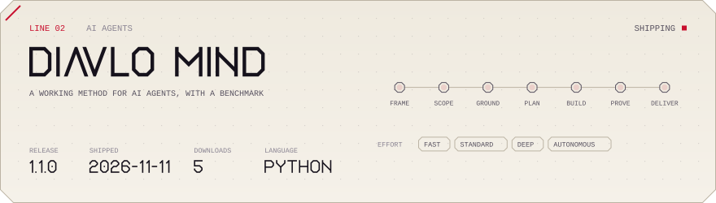
</picture>
<picture>
<source media="(prefers-color-scheme: light)" srcset="assets/rail.day.svg">
<source media="(max-width: 600px)" srcset="assets/line.diavlo-mind.night.tall.svg">
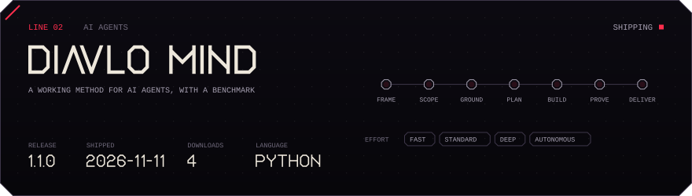
</picture>
</a>

**DIAVLO MIND** · A working method for AI agents, packaged as an Agent Skill, a Claude Code plugin with eight subagents and four portable system prompts. It makes a model write down the requirements, pick an effort level, test what it built and report with evidence. It ships with the benchmark that measures what it changes, including the runs where it changed nothing. 
`Python` `Agent Skills` `Claude Code plugin` &nbsp;·&nbsp; [Repository](https://github.com/Nikolai-coder/diavlo-mind) · [Latest release](https://github.com/Nikolai-coder/diavlo-mind/releases/latest) · [Benchmark results](https://github.com/Nikolai-coder/diavlo-mind/blob/main/evaluation/results/RESULTS.md)

<a href="https://github.com/Nikolai-coder/diavlo-player">
<picture>
<source media="(prefers-color-scheme: dark)" srcset="assets/rail.night.svg">
<source media="(max-width: 600px)" srcset="assets/line.diavlo-player.day.tall.svg">
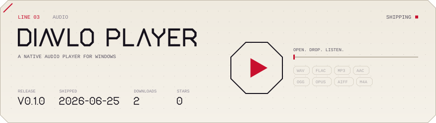
</picture>
<picture>
<source media="(prefers-color-scheme: light)" srcset="assets/rail.day.svg">
<source media="(max-width: 600px)" srcset="assets/line.diavlo-player.night.tall.svg">
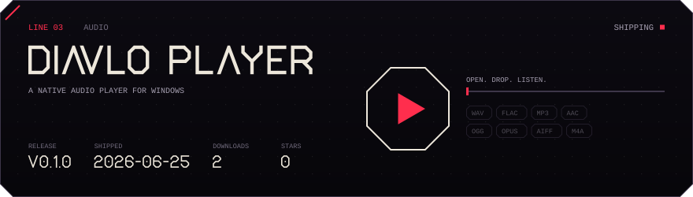
</picture>
</a>

**DIAVLO PLAYER** · A native audio player for Windows with a frameless glass window. Open it, drop a file on it, listen: WAV, FLAC, MP3, AAC, OGG, Opus, AIFF and M4A, from the desktop or the command line. One portable executable, no installer. 
`Rust` `Slint` `Symphonia` `CPAL` `Windows DWM` &nbsp;·&nbsp; [Repository](https://github.com/Nikolai-coder/diavlo-player) · [Latest release](https://github.com/Nikolai-coder/diavlo-player/releases/latest)

<a href="https://github.com/Nikolai-coder/diavlodrop">
<picture>
<source media="(prefers-color-scheme: dark)" srcset="assets/rail.night.svg">
<source media="(max-width: 600px)" srcset="assets/line.diavlodrop.day.tall.svg">
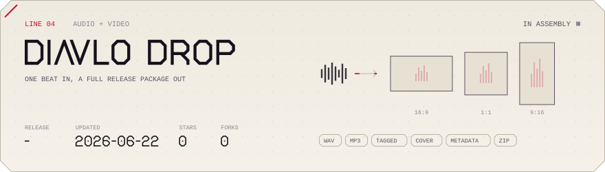
</picture>
<picture>
<source media="(prefers-color-scheme: light)" srcset="assets/rail.day.svg">
<source media="(max-width: 600px)" srcset="assets/line.diavlodrop.night.tall.svg">
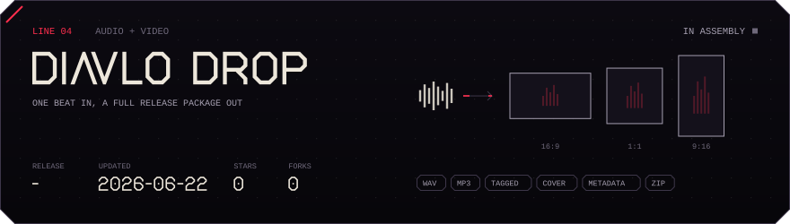
</picture>
</a>

**DIAVLO DROP** · One finished beat in, a complete release package out: masters and tagged previews, cover art, visualizer videos for every aspect ratio and ready-to-paste metadata. Described in its README; no public build has been released yet. 
`Tauri` `Rust` `React` `TypeScript` `FFmpeg` &nbsp;·&nbsp; [Repository](https://github.com/Nikolai-coder/diavlodrop)
<!-- /factory:lines -->

<!-- factory:control -->

<picture>
<source media="(prefers-color-scheme: dark)" srcset="assets/rail.night.svg">
<source media="(max-width: 600px)" srcset="assets/control.day.tall.svg">
</picture>
<picture>
<source media="(prefers-color-scheme: light)" srcset="assets/rail.day.svg">
<source media="(max-width: 600px)" srcset="assets/control.night.tall.svg">
</picture>

Read from the GitHub API on 2026-11-11. A release's download figure is the counter of its largest file, the installer. The signal is GitHub's contribution calendar, summed per week.

<!-- /factory:control -->

<!-- factory:routing -->

<picture>
<source media="(prefers-color-scheme: dark)" srcset="assets/rail.night.svg">
<source media="(max-width: 600px)" srcset="assets/routing.day.tall.svg">
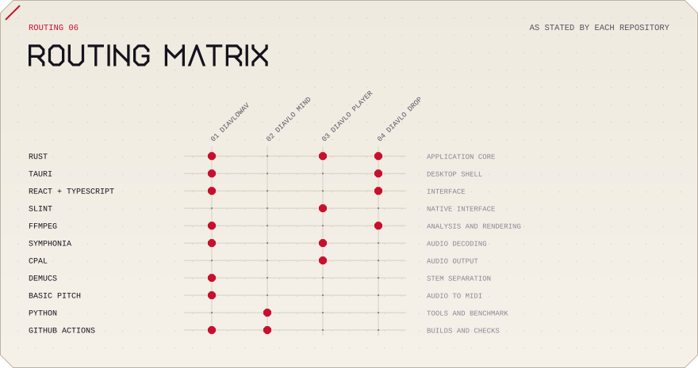
</picture>
<picture>
<source media="(prefers-color-scheme: light)" srcset="assets/rail.day.svg">
<source media="(max-width: 600px)" srcset="assets/routing.night.tall.svg">
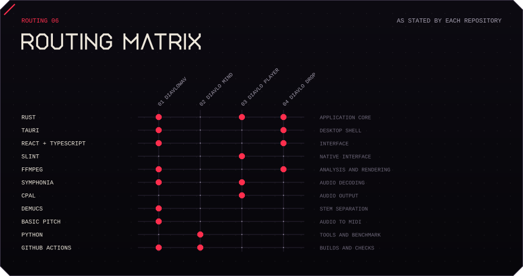
</picture>

<!-- /factory:routing -->

<!-- factory:vault -->

<picture>
<source media="(prefers-color-scheme: dark)" srcset="assets/rail.night.svg">
<source media="(max-width: 600px)" srcset="assets/vault.day.tall.svg">
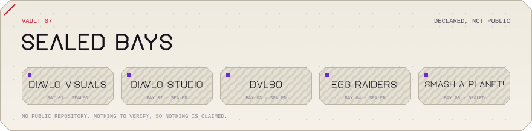
</picture>
<picture>
<source media="(prefers-color-scheme: light)" srcset="assets/rail.day.svg">
<source media="(max-width: 600px)" srcset="assets/vault.night.tall.svg">
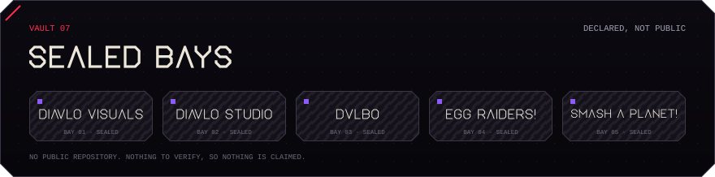
</picture>

<!-- /factory:vault -->

Also on the bench, by the operator's own account: games in Roblox Studio and Unreal Engine, visuals and motion graphics in Blender, and music production. Each gets a line here the day it ships.

<!-- factory:exit -->

<a href="factory/README.md">
<picture>
<source media="(prefers-color-scheme: dark)" srcset="assets/rail.night.svg">
<source media="(max-width: 600px)" srcset="assets/exit.day.tall.svg">
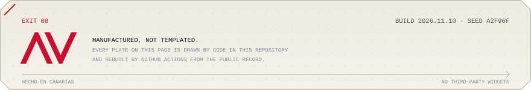
</picture>
<picture>
<source media="(prefers-color-scheme: light)" srcset="assets/rail.day.svg">
<source media="(max-width: 600px)" srcset="assets/exit.night.tall.svg">
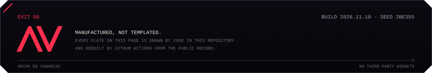
</picture>
</a>

<!-- /factory:exit -->
